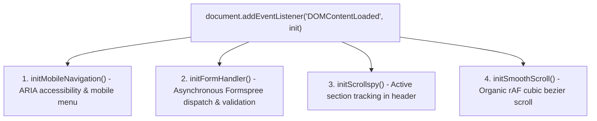

# Kosmios — Architectural Care for Homes & Workspaces

> **"Order is a form of care."**  
> Conscious hygiene, architectural care, and preventive maintenance for private residences, boutique workspaces, and property partners across **Ottawa & the National Capital Region (NCR), Ontario, Canada**.

* **Production URL:** [https://www.kosmios.ca](https://www.kosmios.ca)
* **Stack:** Static Jamstack / Zero-Build Vanilla Web (HTML5, Modern CSS3, ES6+)
* **Compliance Standards:** WCAG 2.1 Nivel AA / AODA (Ontario) & PIPEDA (Canada)

---

## 1. Architecture Philosophy: Zero-Build Static Web

Kosmios avoids heavyweight JavaScript frameworks (React, Vue, Next.js), complex CSS utility engines (Tailwind), and Node.js bundler dependencies (Webpack, Vite) in favor of **native web platform standards**:

* **Perennial Stability:** The codebase has **zero dependency drift**. It will render identically a decade from now without broken `npm` packages or engine incompatibilities.
* **Instant Onboarding:** Any web developer or agency can clone this repository and be productive in **under 5 minutes** without running `npm install` or configuring `.env` variables.
* **Zero Infrastructure Overhead:** Deploys instantly to any static host (GitHub Pages, Cloudflare Pages, Netlify, Apache, Nginx) with lightning-fast Time to First Byte (TTFB).

---

## 2. Quickstart & Local Development

No compilation or build step is required. To serve the site locally with accurate relative path resolution:

### Option A: Python 3 (Built-in)
```bash
python3 -m http.server 8000
# Open http://localhost:8000
```

### Option B: Node / npx (Zero-install)
```bash
npx serve .
# Open http://localhost:3000
```

### Option C: VS Code Live Server
* Open the workspace in VS Code.
* Right-click `index.html` → **"Open with Live Server"** (Port 5500).

---

## 3. Directory Map & Repository Structure

```
Kosmios/
├── index.html                 # Primary landing page & dual service selector
├── for-homes.html             # Dedicated residential cleaning service landing
├── for-business.html          # Dedicated commercial & partner program landing
├── privacy.html               # Canadian PIPEDA privacy policy & data governance
│
├── favicon.ico                # Root multi-resolution icon (16x16, 32x32)
├── site.webmanifest           # Progressive Web App manifest & theme definitions
├── robots.txt                 # Search crawler directives
├── sitemap.xml                # Canonical XML sitemap for SEO indexation
├── README.md                  # Developer onboarding kit & technical guide
├── .gitignore                 # Git ignore rules
│
└── assets/
    ├── css/
    │   └── style.css          # Unified stylesheet (~2,000 lines, 18 clean sections)
    ├── js/
    │   └── main.js            # Vanilla ES6+ controller (navigation, forms, scrollspy)
    └── images/
        ├── 03_Kosmios_Logo_Lockup_A_en.svg   # Vector brand signature (EN)
        ├── 03_Kosmios_Logo_Lockup_A_Order_is_a_form_of_care.svg # Hero vector logo
        ├── 03_Kosmios_Logo_Lockup_D_Order_is_a_form_of_care.svg # Secondary lockup
        ├── favicon.svg        # Native scalable SVG browser icon
        ├── favicon-32x32.png  # Standard tab favicon
        ├── favicon-16x16.png  # Compact tab favicon
        ├── apple-touch-icon.png # iOS home screen icon (180x180)
        └── kosmios-og-card.png # Open Graph & Twitter share card (1200x630)
```

---

## 4. Design System & CSS Architecture

The visual identity is defined through Design Tokens in `:root` at the top of [`assets/css/style.css`](assets/css/style.css):

### 4.1. Chromatic Palette (Pantone & Corporate Specs)
| Token Variable | Hex Code | Purpose & Contrast |
| :--- | :---: | :--- |
| `--color-canvas` | `#F3F8FC` | Paper Canvas (Official background) |
| `--color-canvas-pure` | `#FFFFFF` | Pure White (Card surface elevation) |
| `--color-onyx` / `--color-midnight` | `#0E2A47` | Midnight Navy (Primary text & brand surface; 13.6:1 AAA contrast) |
| `--color-onyx-muted` / `--color-twilight` | `#2C6699` | Twilight (Secondary headers & lead subtitles) |
| `--color-sage` / `--color-aurora-teal` | `#3AA79A` | Aurora Teal (Pantone 7473 C accent, borders, badges & hover) |
| `--color-sage-text` | `#266F66` | Deep Aurora Teal (WCAG 2.1 AA accessible text variant; 5.54:1+) |
| `--color-chalk` | `#DDEBF3` | Ice Chalk (Hairlines, staves & dividers) |

### 4.2. Typographic Geometry (Harmonic Modular Scale)
Governed by a **Major Third (1.250 / 5:4)** ratio on an 8px baseline grid:
* `--font-display`: `'Cormorant Garamond', Georgia, serif`
* `--font-body`: `'Inter', -apple-system, sans-serif`
* `--font-brand`: `'Merriweather', Georgia, serif`

### 4.3. Naming Conventions & Methodology
Styles follow the **BEM (Block Element Modifier)** methodology:
* **Blocks:** `.service-card`, `.manifesto-card`, `.top-bar`, `.main-nav`
* **Elements:** `.service-card__title`, `.manifesto-card__quote`, `.top-bar__badges`
* **Modifiers:** `.btn--primary`, `.btn--block`, `.service-detail-grid--business`

### 4.4. Section Index of [`assets/css/style.css`](assets/css/style.css)
1. **Root Variables & Tokens**
2. **Reset & Global Foundations** (includes `.skip-link` accessible bypass)
3. **Buttons & Interactive Elements**
4. **Staves & Musical Proportion Motifs**
5. **Top Bar**
6. **Persistent Header & Navigation**
7. **Centered Editorial Hero Viewport**
8. **Section Headers**
9. **The Three Movements (Service Grid)**
10. **About & Institutional Trust**
11. **FAQ Accordion**
12. **Contact & Local SEO Section**
13. **Care Type Segmented Control (Form Selector)**
14. **Split Service Divisions (Overview on index.html)**
15. **Dedicated Service Page Layouts**
16. **Legal & Privacy Policy Styling (PIPEDA)**
17. **Persistent Footer**
18. **Responsive Breakpoints (Consolidated Descending Hierarchy):**
    * `<= 1180px`: Intermediate desktop & 4-column card grid wrap to 2x2.
    * `<= 992px`: Tablet viewports, typography scale & mobile hamburger toggle.
    * `<= 860px`: Split service divisions & subpage hero adaptation.
    * `<= 768px`: Portrait tablets, form stack & manifesto quote reflow.
    * `<= 640px`: Single-column cards & hero CTA group stretch.
    * `<= 480px`: Mobile layout, padding reduction & button full-width.
    * `<= 380px`: Ultra-compact screens & segmented toggle wrap.

---

## 5. JavaScript Architecture & Form Integrations

All client-side behavior is managed by [`assets/js/main.js`](assets/js/main.js) (~680 lines) structured in 4 modules:



### 5.1. Formspree Configuration (Lead Intake)
Form routing is centralized at the top of [`assets/js/main.js`](assets/js/main.js):

```javascript
const FORMSPREE_ENDPOINTS = {
  residential: 'https://formspree.io/f/moejblky',
  commercial: 'https://formspree.io/f/mbgdbarn'
};
```

* **To update client recipient emails:** Log in to Formspree and point the respective Form IDs (`moejblky` / `mbgdbarn`) to the client's inbox.
* **To point to new endpoints:** Update the URLs in `FORMSPREE_ENDPOINTS` above.
* **Spam Protection:** All forms include a hidden honeypot (`<input type="text" name="_gotcha" tabindex="-1">`) silently rejected by Formspree if filled by bots.
* **Accessibility & Motion:** Smooth scroll honors the user's OS preference (`prefers-reduced-motion: reduce`) by skipping animations and jumping instantly to anchors.

---

## 6. Standards & Compliance Checklist

* **WCAG 2.1 AA / AODA:**
  * Contrasts verified at 5.5:1+ on light canvas surfaces.
  * Keyboard navigation bypass enabled via `.skip-link` targeting `<main id="main-content">`.
  * Standard `autocomplete` attributes (`name`, `email`, `tel`) implemented on form controls.
* **Canadian Privacy (PIPEDA & CASL):**
  * Full policy documented at [`privacy.html`](privacy.html).
  * Direct contact mechanism: `info@kosmios.ca`.
  * Explicit guarantee of non-disclosure and no selling of customer data.
* **W3C Standards:**
  * 0 HTML5 nesting or unclosed tag errors.
  * Canonical Open Graph & Twitter Cards registered at 1200x630.

---

## 7. Shared Template Maintenance Guidelines (DRY vs. SSG)

Because Kosmios operates as a zero-build static site, the following three components are replicated across the 4 HTML files:
1. **Top Bar:** `<aside class="top-bar">`
2. **Main Header:** `<header class="site-header" id="main-header">`
3. **Footer:** `<footer class="site-footer">`

### How to Maintain:
When adding a new menu link or changing institutional contact details:
1. Update `index.html`.
2. Mirror the edit in `for-homes.html`, `for-business.html`, and `privacy.html`.

### Scalability Threshold (When to migrate to a Static Site Generator):
* **Current status (4 pages):** Pure static HTML is optimal. The maintenance cost of syncing 4 files is vastly lower than the overhead of maintaining Node/npm build dependencies.
* **Threshold (> 5–6 pages):** If Kosmios introduces a blog, neighborhood landing pages (e.g., *Westboro*, *The Glebe*, *Rockcliffe Park*), or a bilingual French version (`EN | FR`), migrate to **Astro** or **Eleventy (11ty)**. Both SSGs allow wrapping components (`<Header />`, `<Footer />`) with zero runtime overhead while retaining 100% of the existing HTML/CSS code intact.

---

## 8. Deployment Workflow

The site is configured for automatic deployment via **GitHub Pages**:

```bash
# 1. Review changes
git status

# 2. Stage and commit
git add .
git commit -m "feat/fix: descriptive summary following Conventional Commits"

# 3. Push to production
git push origin main
```

Upon pushing to the `main` branch, GitHub Pages automatically deploys the updated files to [https://www.kosmios.ca](https://www.kosmios.ca).
